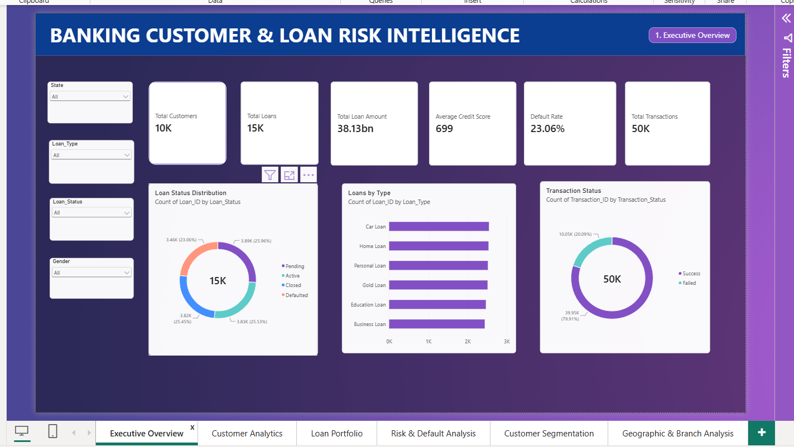
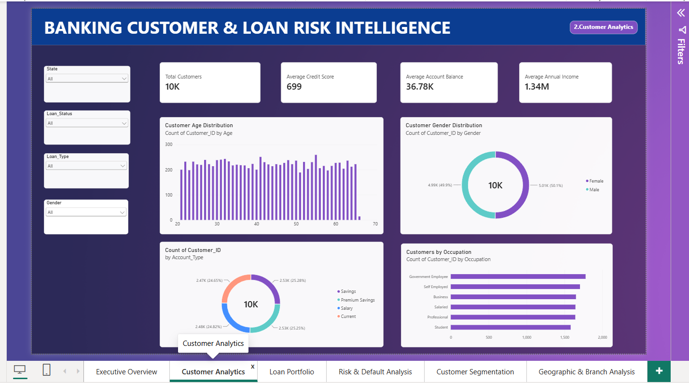
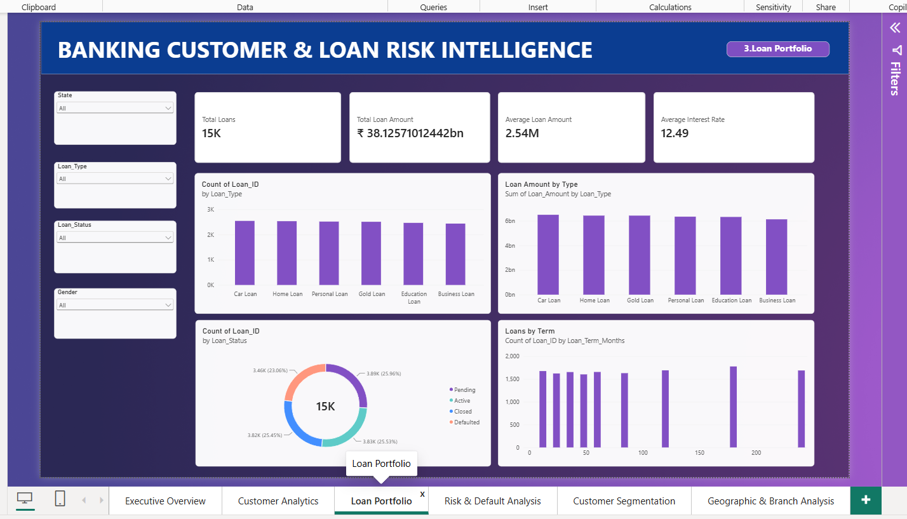
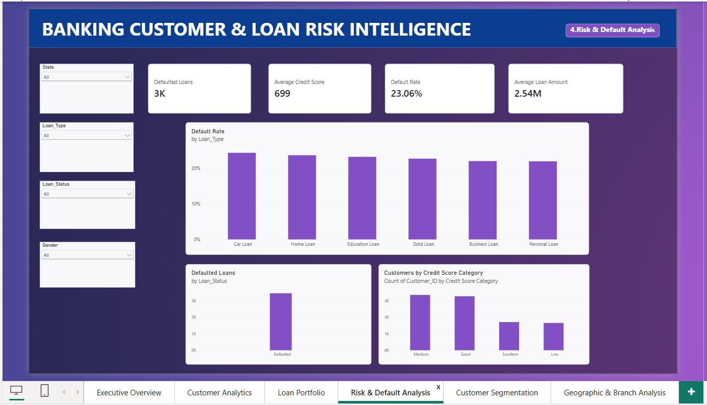
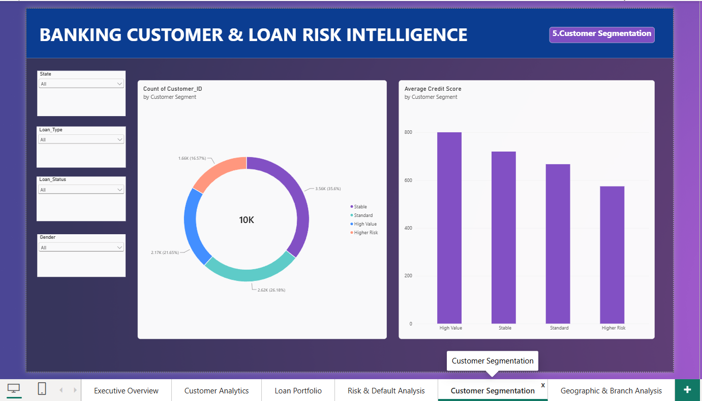
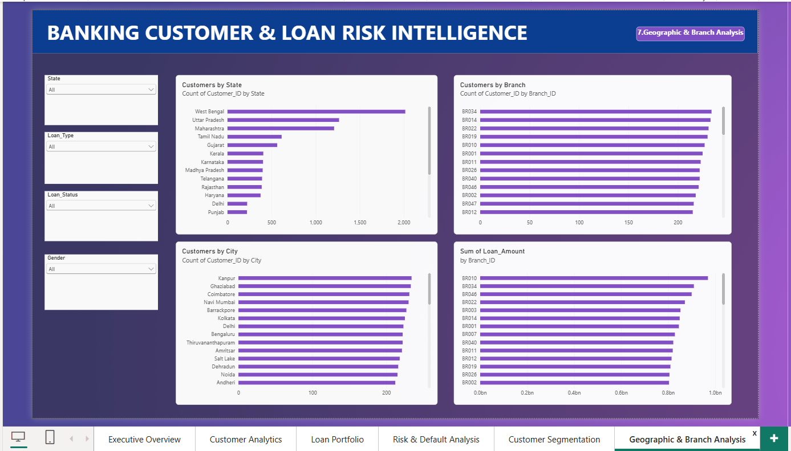

## Power BI Dashboard Preview

### Executive Overview


### Customer Analytics


### Loan Portfolio


### Risk & Default Analysis


### Customer Segmentation


### Branch Analysis



# Banking Customer & Loan Risk Intelligence

A complete end-to-end banking analytics project focused on customer behavior, loan portfolio analysis, transaction insights, and credit risk analysis.

This project uses Excel, SQL, Python, Machine Learning, and Power BI to transform banking data into meaningful business insights and risk indicators.

## Project Objective

The objective of this project is to analyze banking customer, loan, transaction, payment, and branch data to:

- Understand customer demographics and financial behavior
- Analyze the bank's loan portfolio
- Identify loan default and credit risk patterns
- Evaluate branch performance
- Analyze transaction and payment trends
- Segment customers based on financial characteristics
- Build a machine learning model to predict loan defaults
- Create interactive Power BI dashboards for business decision-making


## Dataset

The project uses multiple interconnected banking datasets:

| Dataset | Records | Description |
|---|---:|---|
| Customers | 10,000 | Customer demographics, income, credit score, account balance, and branch details |
| Loans | 15,000 | Loan type, amount, interest rate, term, status, and default information |
| Transactions | 50,000 | Customer transactions, amounts, dates, types, and transaction status |
| Payments | 40,000 | Loan payment details, payment amounts, dates, and payment status |
| Branches | 50 | Branch name, city, state, and branch information |

**Total records:** 115,050+


## Tools & Technologies

- **Excel** — Data cleaning, validation, KPI calculations, and pivot analysis
- **SQL (MySQL)** — Data querying, aggregation, joins, CTEs, and window functions
- **Python** — Data cleaning, exploratory data analysis, visualization, and feature analysis
- **Pandas & NumPy** — Data manipulation and numerical analysis
- **Matplotlib** — Data visualization
- **Scikit-learn** — Machine learning
- **Power BI** — Interactive dashboards and business intelligence
- **GitHub** — Project documentation and version control


## Excel Analysis

Excel was used as the initial data preparation and analysis layer.

### Work Completed

- Cleaned and validated customer, loan, transaction, payment, and branch data
- Checked missing and inconsistent values
- Validated customer age and other important fields
- Created KPI summaries
- Analyzed loan status and transaction status
- Created pivot-based analysis
- Calculated key banking metrics

### Key KPIs

- Total Customers: **10,000**
- Total Loans: **15,000**
- Total Transactions: **50,000**
- Total Payments: **40,000**
- Defaulted Loans: **3,728**
- Default Rate: **24.85%**
- Average Credit Score: **~699**


## SQL Analysis

MySQL was used to perform structured analysis of the banking data.

### Analysis Performed

- Basic customer, loan, transaction, and payment metrics
- Loan type and loan status analysis
- Total and average loan amounts
- Interest rate analysis
- Loan default analysis
- Default rate by loan type and loan status
- Customer-level loan exposure analysis
- Branch performance analysis
- Identification of customers with defaulted loans
- Customer risk analysis using CTEs
- Customer and branch ranking using window functions
- Loan ranking within loan categories
- Monthly transaction analysis
- Running transaction totals

### SQL Concepts Used

- `SELECT`
- `WHERE`
- `GROUP BY`
- `ORDER BY`
- `HAVING`
- `INNER JOIN`
- `LEFT JOIN`
- Aggregate functions
- CTEs (`WITH`)
- `RANK()`
- `PARTITION BY`
- Window functions


## Python Exploratory Data Analysis

Python was used to perform exploratory data analysis and identify patterns in customer, loan, transaction, and payment data.

### Analysis Performed

- Loaded and inspected banking datasets using Pandas
- Checked data types and missing values
- Analyzed customer demographics
- Analyzed account types and occupations
- Examined age and credit score distributions
- Analyzed account balances and annual income
- Studied loan types and loan statuses
- Calculated default rates by loan type
- Compared defaulted and non-defaulted loans
- Analyzed transaction trends over time
- Examined payment behavior
- Performed correlation analysis
- Identified outliers using visual analysis
- Performed branch-level analysis
- Studied customer financial behavior

### Python Libraries Used

- Pandas
- NumPy
- Matplotlib


## Machine Learning

A machine learning model was developed to predict loan default risk.

### Approach

- Selected relevant customer and loan features
- Created a `Default_Flag` target variable
- Split the data into training and testing sets
- Applied feature scaling
- Trained a Logistic Regression model
- Trained a Random Forest model
- Evaluated model performance using:
  - Accuracy
  - Precision
  - Recall
  - F1-score
  - ROC-AUC
  - Confusion Matrix
- Compared model performance
- Analyzed feature importance

### Features Used

- Age
- Credit Score
- Annual Income
- Account Balance
- Loan Amount
- Interest Rate
- Loan Term

### Models Used

- Logistic Regression
- Random Forest

> **Note:** The loan default data is synthetically generated. Default probability was influenced by selected financial factors such as credit score, income, loan amount, and interest rate. Therefore, model performance should be considered illustrative rather than real-world predictive evidence.


## Power BI Dashboard

Power BI was used to create interactive dashboards for monitoring banking performance and customer risk.

### Dashboard Pages

#### 1. Executive Overview
- Total Customers
- Total Loans
- Total Loan Amount
- Default Rate
- Average Credit Score
- Total Transactions
- Loan Status Distribution
- Loans by Type
- Transaction Status

#### 2. Customer Analytics
- Customer demographics
- Age distribution
- Gender distribution
- Account type analysis
- Occupation analysis
- Average credit score
- Average account balance
- Average annual income

#### 3. Loan Portfolio
- Total loans
- Total loan amount
- Average loan amount
- Average interest rate
- Loan type analysis
- Loan amount by type
- Loan status distribution
- Loan term analysis

#### 4. Risk & Default Analysis
- Defaulted loans
- Default rate
- Default analysis by loan type
- Credit score categories
- Default-related customer and loan insights

#### 5. Customer Segmentation
- High Value customers
- Stable customers
- Higher Risk customers
- Standard customers
- Segment-wise income and credit score analysis

#### 6. Geographic & Branch Analysis
- Customers by state and city
- Branch performance
- Branch loan analysis
- Geographic banking insights


## Key Business Insights

The analysis provides several important banking insights:

- The dataset contains more than 115,000 banking records across five interconnected datasets.
- The loan portfolio contains 15,000 loans across different loan categories.
- Default analysis helps identify segments with higher credit risk.
- Credit score, annual income, loan amount, and interest rate provide useful indicators for risk analysis.
- Customer-level loan exposure helps identify customers with significant outstanding financial exposure.
- Branch-level analysis helps compare loan activity across different locations.
- Transaction and payment analysis provides insights into customer financial activity.
- Customer segmentation helps distinguish high-value, stable, standard, and higher-risk customers.
- Machine learning provides an additional approach for evaluating potential loan default risk.
- Power BI dashboards make the analysis easier to monitor and communicate.


## Project Structure

```text
Banking-Analytics/
│
├── data/
│   ├── customers.csv
│   ├── loans.csv
│   ├── loans_ml.csv
│   ├── transactions.csv
│   ├── payments.csv
│   └── branches.csv
│
├── excel/
│   └── Banking_Analytics_Excel.xlsx
│
├── sql/
│   ├── 01_basic_analysis.sql
│   ├── 02_loan_analysis.sql
│   ├── 03_risk_analysis.sql
│   ├── 04_customer_loan_analysis.sql
│   └── 05_advanced_sql.sql
│
├── python/
│   ├── 01_...
│   ├── 02_banking_eda.ipynb
│   └── 03_loan_default_prediction.ipynb
│
├── powerbi/
│   └── Banking_Analytics.pbix
│
├── screenshots/
│
└── README.md


---

## Step 12 — Add Skills Demonstrated

```markdown
## Skills Demonstrated

### Data Analytics
- Data Cleaning
- Data Validation
- Exploratory Data Analysis
- KPI Development
- Business Analysis
- Customer Segmentation

### SQL
- MySQL
- Aggregations
- Joins
- CTEs
- Window Functions
- Ranking
- Risk Analysis

### Python
- Pandas
- NumPy
- Matplotlib
- Data Analysis
- Data Visualization

### Machine Learning
- Logistic Regression
- Random Forest
- Feature Engineering
- Train-Test Split
- Classification Metrics
- ROC-AUC
- Feature Importance

### Business Intelligence
- Power BI
- DAX
- Data Modeling
- Relationships
- Interactive Dashboards
- KPI Cards
- Slicers


## Future Improvements

- Add more real-world banking datasets
- Improve the synthetic data generation process
- Test additional machine learning algorithms
- Perform hyperparameter tuning
- Add explainable AI techniques such as SHAP
- Develop customer lifetime value analysis
- Add advanced fraud detection analysis
- Create automated dashboard refresh pipelines
- Deploy the analytics solution to a cloud environment


## Author

**Pausali Karmakar**

B.Tech — Information Technology

Interested in Data Analytics, Business Intelligence, Machine Learning, and Banking Analytics.